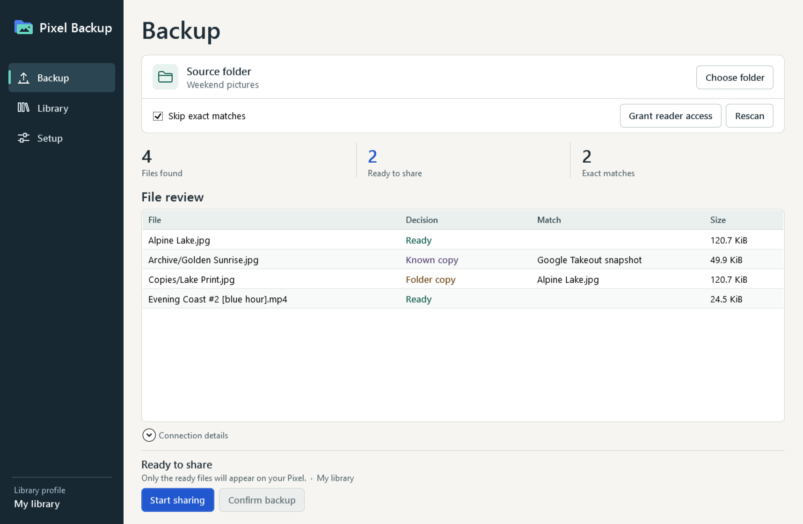
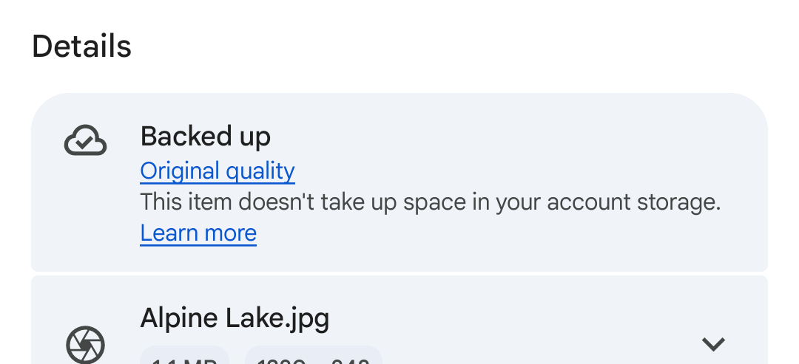
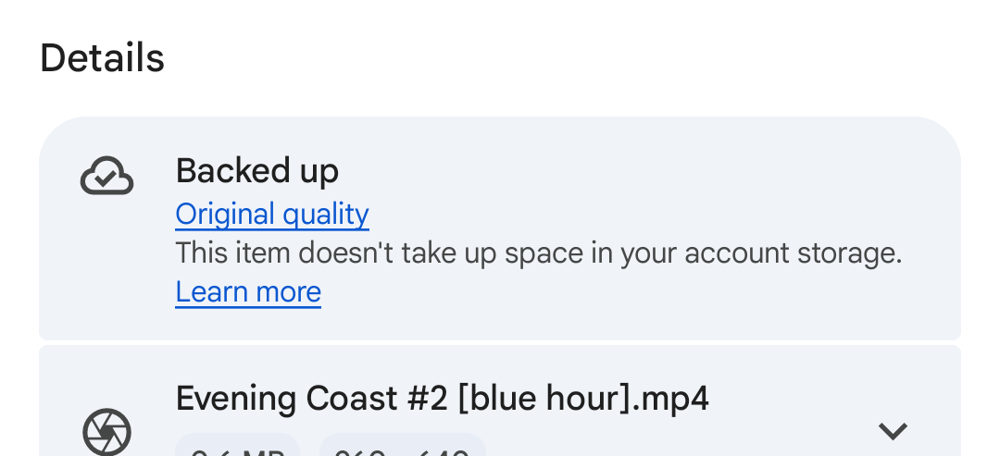
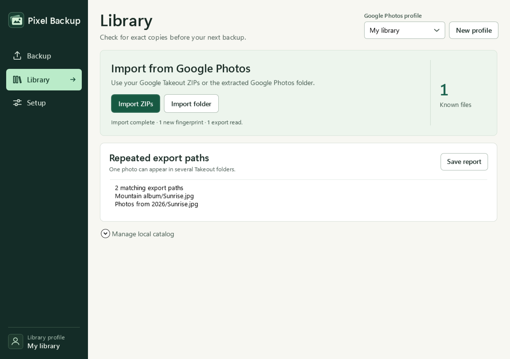

# Pixel Backup

Back up a Windows photo folder through the Google Photos app on your original Pixel. Select an album on the PC, review exact duplicates and share it over Wi-Fi. The phone reads the selected originals from Windows as it needs them. A library larger than the phone's free space can stay on the PC.

Vivek Revankar (@master-hax) developed the original Pixel storage mount that inspired this app. [Original project](https://github.com/master-hax/pixel-backup-gang) · [Contributors and references](#credits)

**[Download Pixel Backup for Windows](https://github.com/supthunder/pixelbackup/releases/latest/download/Pixel-Backup-Windows-x64.zip)** · [SHA-256 checksum](https://github.com/supthunder/pixelbackup/releases/latest/download/Pixel-Backup-Windows-x64.zip.sha256) · [Release notes](https://github.com/supthunder/pixelbackup/releases)



## Get the Windows app

**Portable release.** Extract the Windows ZIP into a folder, keep its contents together and open **Pixel Backup.exe**. The app runs on 64-bit Windows 10 or 11 with .NET Framework 4.8 and Windows PowerShell 5.1. It opens as your ordinary Windows user. Pairing and publishing a Windows share can request administrator approval. If Windows blocks a downloaded helper, follow the ZIP verification step in the setup guide. [Windows setup](docs/PC_FOLDER.md#one-time-windows-and-pixel-setup)

**From source.** Double-click `windows\Select-PixelFolder.cmd` in a checkout. It builds the app, installs or updates your **Pixel Backup** desktop shortcut, and opens the app. To build and install the shortcut from Windows PowerShell, use the command below. [Windows build script](windows/Build-PixelBackup.ps1)

```powershell
.\windows\Build-PixelBackup.ps1 -InstallDesktopShortcut
```

## Back up your first folder

1. **Pair once.** Connect your rooted 2016 Pixel (`sailfish`) or Pixel XL (`marlin`) by USB, unlock the owner profile and open **Setup → Pair phone**. Choose the PC's LAN IPv4 address and approve USB debugging and Magisk on the phone. The paired watcher runs on stock Android 10 and waits for your selection after unlock. If you already paired with the earlier Windows picker, use **Update phone watcher** before sharing a desktop batch. [Setup and upgrades](docs/PC_FOLDER.md)
2. **Choose a folder.** In **Backup**, select **Choose folder**. Scanning starts automatically. Try a fresh JPEG and a short MP4 first. The app groups byte-identical files and shows matches from your selected local library profile. To compare against an existing Google Photos account, import its Takeout export in **Library**. [Duplicate guide](docs/DUPLICATES.md)
3. **Start sharing.** Keep the PC awake and the phone on the same private network. The Pixel reads the planned files from a read-only Windows share at `/storage/emulated/0/PixelBackup`. Open Google Photos → **Collections → On this device** and enable backup for the folder under the Google account you want to use. Check the folders Photos shows for nested albums. [Mount and verify](docs/PC_FOLDER.md#mount-and-verify)
4. **Verify and finish.** In Google Photos, check each test item's **Details** for **Backed up**, **Original quality** and its account-storage message. Once backup finishes, close the previews and use **Stop sharing** on Windows. Select **Confirm backup** after the share closes cleanly. Check the profile and file count before recording the batch. Windows can observe reads from the Pixel. Google Photos supplies the upload result. [Google Photos backup checks](https://support.google.com/photos/answer/6193313?co=GENIE.Platform%3DAndroid&hl=en)

## What the original Pixel actually backed up

On a first-generation Pixel running stock Android 10 build `QP1A.191005.007.A3`, the desktop app selected two of four sample files. The Pixel read **Alpine Lake.jpg** and **Evening Coast #2 [blue hour].mp4** byte-for-byte and denied access to the renamed JPEG and the file matched by Takeout. Google Photos automatically backed up both selected files and reported zero account storage for each. This test ran the released selection through a USB debugging tunnel. [Filtered backup test](docs/STORAGE_REVIEW.md#filtered-desktop-backup)

| JPEG from Windows | MP4 from Windows |
| --- | --- |
|  |  |

The Pixel also discovered the two-file selection automatically on an authenticated SMB test server over USB. In the earlier Wi-Fi test, Windows recorded signed SMB 3.1.1 reads from this Pixel for a separate JPEG and MP4. Both reopened in Google Photos after the share disconnected. [Wi-Fi test and screenshots](docs/STORAGE_REVIEW.md#on-device-result)

Google documents unlimited Original quality for the first-generation Pixel. Its original hardware offer describes media taken with the phone. Check a fresh imported item on your own account before starting a large library. Mounting removes the deliberate full-file copy to phone storage. Android and Google Photos can still write indexes, thumbnails and temporary files. [Google quality policy](https://support.google.com/photos/answer/6220791?co=GENIE.Platform%3DAndroid&hl=en) · [Original hardware notes](https://support.google.com/pixelphone/answer/16043605?hl=en) · [Storage review and alternatives](docs/STORAGE_REVIEW.md)

## Existing libraries and other storage options

- **Already backed up thousands of files?** Import a Google Photos Takeout ZIP or extracted export into the local profile for that account. By default, the app skips exact SHA-256 matches. Similar pictures, edited files and previously compressed versions can have different bytes. [Comparing an existing library](docs/DUPLICATES.md)
- **Prefer a USB drive or NAS?** The original project exposes a USB drive’s `the_binding` folder to Photos on a rooted Android 10 phone. Its native NFSv3 route also supports specific Pixel builds using matching boot images. The Windows app's SMB route uses the existing FUSE driver in the stock kernel. [Docked drive and NFS options](docs/STORAGE_REVIEW.md#using-a-docked-drive)

<details>
<summary>See a Takeout album and year folder resolve to one fingerprint</summary>



Both paths in this sample contain the same JPEG. To investigate items in the cloud, open the intended account in Google Photos. The report describes the files in your export.

</details>

## Credits

**Vivek Revankar (@master-hax)** created **Pixel Backup Gang** and its external-drive mount for the original Pixel. He also implemented upstream's native NFS support. **@supthunder** started the Windows folder-picker work in the historical fork and maintains this standalone Windows project. [Original Pixel Backup Gang](https://github.com/master-hax/pixel-backup-gang) · [Original NFS contribution](https://github.com/master-hax/pixel-backup-gang/commit/e30d97a3c4674859139655b61203780933e55634) · [Historical Windows fork](https://github.com/supthunder/pixel-backup-gang)

| Contribution | People and primary sources |
| --- | --- |
| Windows shares on real Pixels | **@FovenX3** reported using rclone/FUSE over SMB on both 2016 models. **Xinyang Li (@tautomer)** documented a read-only NAS mount on a Pixel XL and its indexing speed. [Original SMB report](https://github.com/master-hax/pixel-backup-gang/issues/7) · [Pixel XL write-up](https://tautomer.github.io/posts/google_photos_pixel_xl/) |
| Upstream storage and installer work | **@ersil** tested and hardened NFS automount, **@brosahay** added Android 11+ VFAT handling, **@SamPom100** documented macOS ext4 formatting, and **@TomTomNavigator** updated the upstream installer to use the newer script release. [NFS automount](https://github.com/master-hax/pixel-backup-gang/pull/67) · [VFAT](https://github.com/master-hax/pixel-backup-gang/pull/33) · [ext4](https://github.com/master-hax/pixel-backup-gang/pull/54) · [Installer](https://github.com/master-hax/pixel-backup-gang/pull/46) |
| Earlier experiments | **@piyushgarg** and **@AvinashReddy3108** developed earlier Magisk rclone-mount modules used in community experiments. **@lightc786** described feeding a docked drive over the network, and **@vegedb** documented internal writes during a manual upload. [Original mount module](https://github.com/Magisk-Modules-Repo/com.piyushgarg.rclone) · [Module fork](https://github.com/AvinashReddy3108/rclone-mount-magisk) · [Docked transfer](https://github.com/master-hax/pixel-backup-gang/issues/20#issuecomment-2394439392) · [Flash-write investigation](https://github.com/master-hax/pixel-backup-gang/issues/30) |
| Google Takeout research | **Jean François Cassan (@simulot)** and the immich-go contributors documented album and year folders, metadata sidecars and localized export layouts. Their observations informed the library comparison guide. [Takeout layout notes](https://github.com/simulot/immich-go/blob/main/docs/misc/google-takeout.md) |
| Software the app uses | **Nick Craig-Wood (@ncw)** and the rclone contributors provide the SMB client and mount. **Termux** packages rclone and the **libfuse** helper for Android. **John Wu (@topjohnwu)** and Magisk contributors provide root access and the boot-script mechanism. [rclone authors](https://rclone.org/authors/) · [Termux packages](https://github.com/termux/termux-packages) · [libfuse](https://github.com/libfuse/libfuse) · [Magisk](https://github.com/topjohnwu/Magisk) |

The pinned rclone release uses **go-smb2** and **bazil.org/fuse** for this mount. Windows supplies file sharing and SQLite, Android supplies the platform tools and media index, and Google Photos performs the backup. [Go SMB client](https://github.com/cloudsoda/go-smb2) · [Go FUSE bindings](https://github.com/bazil/fuse) · [Windows SMB](https://learn.microsoft.com/en-us/windows-server/storage/file-server/file-server-smb-overview) · [SQLite](https://sqlite.org/) · [Android Platform Tools](https://developer.android.com/tools/releases/platform-tools) · [Android MediaStore](https://developer.android.com/reference/android/provider/MediaStore)
