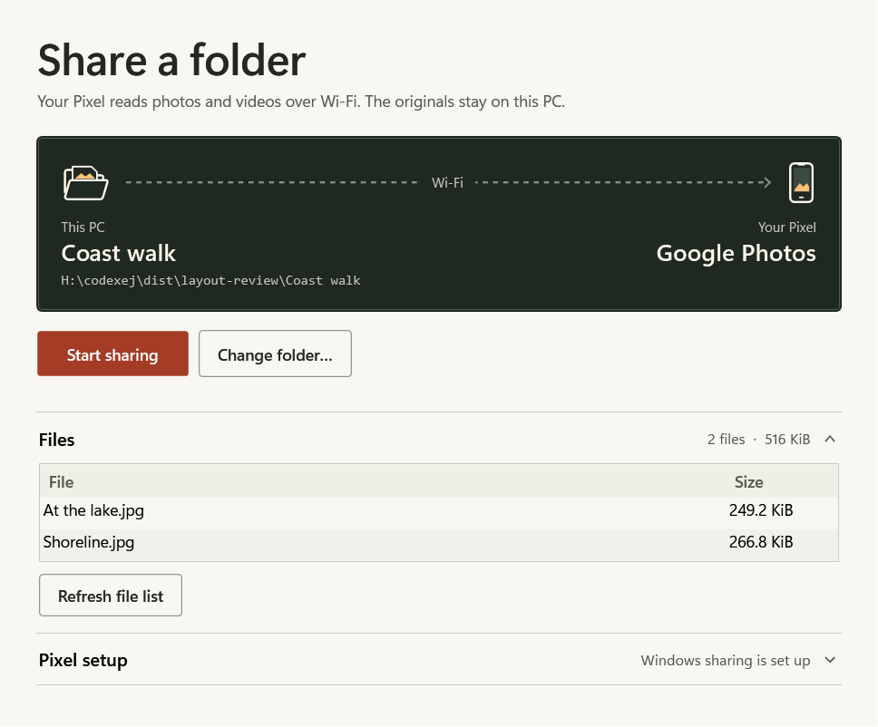

# Pixel Backup

Back up a Windows photo folder through Google Photos on a rooted, first-generation Pixel. Choose or drop a folder, then select **Start sharing**. The Pixel reads the photos and videos from the PC over Wi-Fi as it needs them, so the folder can be larger than the phone's free space. Select **Stop sharing** when Google Photos finishes.

Vivek Revankar (@master-hax) developed the original Pixel storage mount that inspired this app. [Original project](https://github.com/master-hax/pixel-backup-gang) · [Contributors and references](#credits)

**[Download the Windows v1.1.0 release](https://github.com/supthunder/pixelbackup/releases/download/v1.1.0/Pixel-Backup-Windows-x64.zip)** · [SHA-256 checksum](https://github.com/supthunder/pixelbackup/releases/download/v1.1.0/Pixel-Backup-Windows-x64.zip.sha256) · [v1.1.0 release notes](https://github.com/supthunder/pixelbackup/releases/tag/v1.1.0)

**[Download the Android companion](https://github.com/supthunder/pixelbackup/releases/download/companion-v1.0.0/Pixel-Backup-Android.apk)** · [APK checksum](https://github.com/supthunder/pixelbackup/releases/download/companion-v1.0.0/Pixel-Backup-Android.apk.sha256) · [Monitor a backup on your Pixel](docs/ANDROID_COMPANION.md)

## Get the Windows app

**Portable v1.1.0 release.** Extract the Windows ZIP into a folder, keep its contents together and open **Pixel Backup.exe**. The app runs on 64-bit Windows 10 or 11 with .NET Framework 4.8 and Windows PowerShell 5.1. It opens as your ordinary Windows user. Pairing and publishing a Windows share can request administrator approval. The release guide shows the screens in that version. [v1.1.0 setup and ZIP verification](https://github.com/supthunder/pixelbackup/blob/v1.1.0/docs/PC_FOLDER.md)

**One-page app from source.** Double-click `windows\Select-PixelFolder.cmd` in this checkout. It builds the app, installs or updates your **Pixel Backup** desktop shortcut, and opens the app. To build and install the shortcut from Windows PowerShell, use the command below. [Windows build script](windows/Build-PixelBackup.ps1)

```powershell
.\windows\Build-PixelBackup.ps1 -InstallDesktopShortcut
```



## Back up your first folder

1. **Choose folder.** Select a local photo folder or drag it from Explorer onto the app. The scan uses filenames and file metadata to find supported photos and videos in the folder and its subfolders. Every eligible path is included, even when two paths contain identical photos. Open the file list to see their relative paths.
2. **Start sharing.** For first-time pairing, connect and unlock your 2016 Pixel (`sailfish`) or Pixel XL (`marlin`) running stock Android 10 with Magisk. Expand **Pixel setup** on the same page, pair over USB, and unplug the cable once pairing succeeds. Select **Start sharing** and keep the PC awake and the phone on the same private network. The Pixel reads the originals from a read-only Windows share at `/storage/emulated/0/PixelBackup`. [Setup and upgrades](docs/PC_FOLDER.md)
3. **Stop sharing when Google Photos finishes.** On the Pixel, check your Google Photos account. Under **Collections → On this device**, open the shared folder and enable its backup. For nested albums, check the folders Photos shows. In a photo or video's **Details**, look for **Backed up**. Close open previews and select **Stop sharing** on Windows when the backup is complete. [Mount and verify](docs/PC_FOLDER.md#mount-and-verify) · [Google Photos backup checks](https://support.google.com/photos/answer/6193313?co=GENIE.Platform%3DAndroid&hl=en)

## Follow progress on the Pixel

Open **Pixel Backup** on the phone to follow the Google Photos queue. With notification access, the companion can read the remaining count that Photos publishes. You can also enter the count from Photos yourself. Falling counts let it estimate time remaining. On a rooted original Pixel, the live meter shows how fast Google Photos is sending data over Wi-Fi and how many bytes it sent while you were measuring. [Android setup and permissions](docs/ANDROID_COMPANION.md) · [See the live meter on an original Pixel](docs/evidence/android-companion-live.png)

## What the original Pixel actually backed up

In the v1.0 hardware test, a first-generation Pixel running stock Android 10 build `QP1A.191005.007.A3` read **Alpine Lake.jpg** and **Evening Coast #2 [blue hour].mp4** from a test server through a USB debugging tunnel. The desktop app supplied the file list. Both files matched the Windows originals byte-for-byte, and Google Photos reported that each backup used zero account storage. [v1.0 hardware test](docs/STORAGE_REVIEW.md#filtered-desktop-backup)

| JPEG from Windows | MP4 from Windows |
| --- | --- |
|  |  |

The Pixel also discovered the two-file selection automatically on an authenticated SMB test server over USB. In the earlier Wi-Fi test, Windows recorded signed SMB 3.1.1 reads from this Pixel for a separate JPEG and MP4. Both reopened in Google Photos after the share disconnected. [Wi-Fi test and screenshots](docs/STORAGE_REVIEW.md#on-device-result)

Google documents unlimited Original quality for the first-generation Pixel. Its original hardware offer describes media taken with the phone. Check a fresh imported item on your own account before starting a large library. Mounting removes the deliberate full-file copy to phone storage. Android and Google Photos can still write indexes, thumbnails and temporary files. [Google quality policy](https://support.google.com/photos/answer/6220791?co=GENIE.Platform%3DAndroid&hl=en) · [Original hardware notes](https://support.google.com/pixelphone/answer/16043605?hl=en) · [Storage review and alternatives](docs/STORAGE_REVIEW.md)

## USB drives and network storage

The Windows app can share a folder on a drive attached to the PC over SMB using the Pixel's stock kernel. To use a drive attached to the phone, upstream’s USB mount exposes the drive’s `the_binding` folder to Google Photos. Upstream’s native NFSv3 route supports specific Pixel builds with matching boot images. [USB drive TODO](TODO.md#back-up-directly-from-a-usb-drive) · [Docked drive and NFS options](docs/STORAGE_REVIEW.md#using-a-docked-drive)

## Credits

**Vivek Revankar (@master-hax)** created **Pixel Backup Gang** and its external-drive mount for the original Pixel. He also implemented upstream's native NFS support. **@supthunder** started the Windows folder-picker work in the historical fork and maintains this standalone Windows project. [Original Pixel Backup Gang](https://github.com/master-hax/pixel-backup-gang) · [Original NFS contribution](https://github.com/master-hax/pixel-backup-gang/commit/e30d97a3c4674859139655b61203780933e55634) · [Historical Windows fork](https://github.com/supthunder/pixel-backup-gang)

| Contribution | People and primary sources |
| --- | --- |
| Windows shares on real Pixels | **@FovenX3** reported using rclone/FUSE over SMB on both 2016 models. **Xinyang Li (@tautomer)** documented a read-only NAS mount on a Pixel XL and its indexing speed. [Original SMB report](https://github.com/master-hax/pixel-backup-gang/issues/7) · [Pixel XL write-up](https://tautomer.github.io/posts/google_photos_pixel_xl/) |
| Upstream storage and installer work | **@ersil** tested and hardened NFS automount, **@brosahay** added Android 11+ VFAT handling, **@SamPom100** documented macOS ext4 formatting, and **@TomTomNavigator** updated the upstream installer to use the newer script release. [NFS automount](https://github.com/master-hax/pixel-backup-gang/pull/67) · [VFAT](https://github.com/master-hax/pixel-backup-gang/pull/33) · [ext4](https://github.com/master-hax/pixel-backup-gang/pull/54) · [Installer](https://github.com/master-hax/pixel-backup-gang/pull/46) |
| Earlier experiments | **@piyushgarg** and **@AvinashReddy3108** developed earlier Magisk rclone-mount modules used in community experiments. **@lightc786** described feeding a docked drive over the network, and **@vegedb** documented internal writes during a manual upload. [Original mount module](https://github.com/Magisk-Modules-Repo/com.piyushgarg.rclone) · [Module fork](https://github.com/AvinashReddy3108/rclone-mount-magisk) · [Docked transfer](https://github.com/master-hax/pixel-backup-gang/issues/20#issuecomment-2394439392) · [Flash-write investigation](https://github.com/master-hax/pixel-backup-gang/issues/30) |
| Historical Google Takeout research | **Jean François Cassan (@simulot)** and the immich-go contributors documented album and year folders, metadata sidecars and localized export layouts. Their work informed the v1.1.0 library comparison guide. [v1.1.0 guide](https://github.com/supthunder/pixelbackup/blob/v1.1.0/docs/DUPLICATES.md) · [Takeout layout notes](https://github.com/simulot/immich-go/blob/main/docs/misc/google-takeout.md) |
| Software the app uses | **Nick Craig-Wood (@ncw)** and the rclone contributors provide the SMB client and mount. **Termux** packages rclone and the **libfuse** helper for Android. **John Wu (@topjohnwu)** and Magisk contributors provide root access and the boot-script mechanism. [rclone authors](https://rclone.org/authors/) · [Termux packages](https://github.com/termux/termux-packages) · [libfuse](https://github.com/libfuse/libfuse) · [Magisk](https://github.com/topjohnwu/Magisk) |

The pinned rclone release uses **go-smb2** and **bazil.org/fuse** for this mount. Windows supplies file sharing, Android supplies the platform tools and media index, and Google Photos performs the backup. [Go SMB client](https://github.com/cloudsoda/go-smb2) · [Go FUSE bindings](https://github.com/bazil/fuse) · [Windows SMB](https://learn.microsoft.com/en-us/windows-server/storage/file-server/file-server-smb-overview) · [Android Platform Tools](https://developer.android.com/tools/releases/platform-tools) · [Android MediaStore](https://developer.android.com/reference/android/provider/MediaStore)

The v1.1.0 welcome landscape was generated with OpenAI's built-in image generation. The Pixel Backup app icon is original vector artwork.

<details>
<summary>Welcome artwork and generation prompt</summary>

[Welcome landscape](windows/app/Welcome.jpg) · [Editable app icon](windows/app/PixelBackup.svg)

> A panoramic fine-art landscape photograph for the welcome panel of Pixel Backup, a Windows photography backup app. A mirror-still alpine lake in the Dolomites at first morning light, dark evergreen conifers and their shadowed reflections on the left, layers of blue-green mountains and one sunlit pale stone peak toward the right, soft apricot light on the rock, moody warm mist. Wide 3:1 horizontal landscape composition, camera on shore. Reserve the left 48% as naturally deep forest-green low-contrast negative space with dark water and tree silhouettes so white UI type can be overlaid. The photographic focus, warm light, distant peaks, and an interesting arc of shoreline are concentrated on the right 52%. Finely detailed, subtle analog film texture, premium nature photography. Full bleed, real landscape, no words, no UI, no frames, no logos, no people.

</details>
