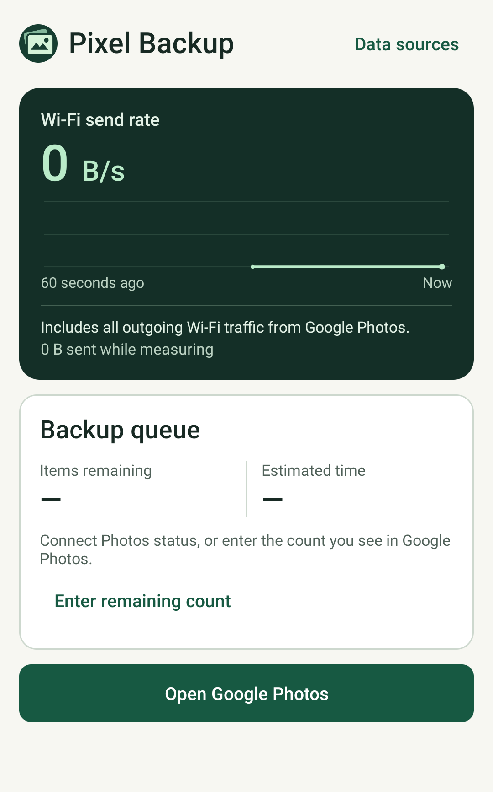
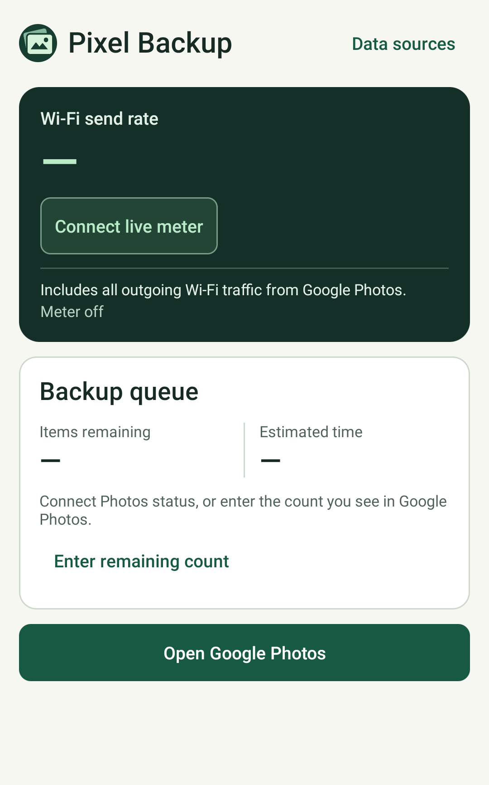

# Monitor a backup on the Pixel

Open **Pixel Backup** on the Pixel that runs Google Photos to see the reported backup queue, the estimated time remaining when the queue is moving, and the Photos app’s Wi-Fi send rate. Google Photos uploads the originals and reports which items reached the selected account. [Windows folder setup](PC_FOLDER.md) · [Google Photos backup status](https://support.google.com/photos/answer/6193313?co=GENIE.Platform%3DAndroid&hl=en)

## Install on the Pixel

1. **Install the APK.** Download the Android APK from the companion release and open it on the phone. Android may ask you to allow this browser or file manager to install the download. The launcher name is **Pixel Backup**, and the package is `dev.supthunder.pixelbackup`. The companion requires Android 10 or later. The Wi-Fi meter specifically supports the original Pixel (`sailfish`) and Pixel XL (`marlin`) running Android 10 with Magisk and the stock Wi-Fi counter. [Android APK](https://github.com/supthunder/pixelbackup/releases/download/companion-v1.0.0/Pixel-Backup-Android.apk) · [Companion release and checksum](https://github.com/supthunder/pixelbackup/releases/tag/companion-v1.0.0) · [Android's installation instructions](https://developer.android.com/distribute/marketing-tools/alternative-distribution#unknown-sources)
2. **Start a backup in Google Photos.** For a Windows folder, use **Start sharing** on the PC. On the Pixel, use **Open Google Photos**, check the destination account, and enable the folder under **Photos settings → Backup → Back up device folders**. Tap your profile picture to see the queue in Photos. [Mount and verify a Windows folder](PC_FOLDER.md#mount-and-verify)
3. **Choose a source for the queue.** In Pixel Backup, select **Data sources → Connect Photos status → Open notification access**. Enable **Pixel Backup** on the Android settings screen, then return. If Photos doesn’t post a recognized count, **Enter remaining count** on the dashboard accepts the number you see in Photos. Both the automatic count and manual entry work without root. [Android notification listeners](https://developer.android.com/reference/android/service/notification/NotificationListenerService)
4. **Enable the Wi-Fi meter if you want a rate.** Tap **Connect live meter** beneath **Wi-Fi send rate** or in **Data sources**. Choose **Continue to Magisk** and grant access if Magisk asks. Keep the companion visible to see the rate and its one-minute chart. Use **Data sources → Stop live meter** to end the reading. Sampling also stops when the companion leaves the screen. Enable the meter again when you return.

If you downloaded the APK to Windows, have `adb` on your search path, and already authorized the USB-connected Pixel, open PowerShell in the download folder and run `adb -d install -r .\Pixel-Backup-Android.apk`. Then open **Pixel Backup** on the phone. [Android USB installation](https://developer.android.com/tools/adb#move)

## Read the status

| Signal | What it measures |
| --- | --- |
| Google Photos status | Backup activity that Photos publishes in a recognized notification on this phone. The wording available to the companion depends on the version and language of Google Photos. |
| Items remaining | The queue count Photos reports, or the value you entered manually. Other enabled device folders can contribute to the same queue as your Windows batch. |
| Estimated time | Time for the observed number of items to finish at the recent pace. A short JPEG and a long video each count as one item. The estimate uses changing item counts and has no measurement of the bytes left in Google’s upload queue. |
| Wi-Fi send rate | The chart shows the last minute of Google Photos’ outgoing Wi-Fi traffic on `wlan0`. The line below it totals bytes sent since this uninterrupted measurement began. Both include other Photos requests and retries. |

The phone can upload a large video for some time before its item count falls. A measured **0 B/s** means the counter saw no outbound Wi-Fi activity during the reading. A dash can mean the meter is off, waiting for its first samples, or unable to read the counter. Neither a quiet meter nor a disappearing notification establishes what reached the cloud. Use **Open Google Photos** to check backup status. [Google Photos backup troubleshooting](https://support.google.com/photos/answer/6174018?hl=en)

## How to get an estimate

For an automatic estimate, leave the companion open while Photos publishes counts. The app needs an initial count and two decreases spanning at least ten seconds. If the queue grows, pauses or stays at the same count for 45 seconds, it waits for a fresh trend.

For a manual estimate, use **Enter remaining count** with the value shown in Photos. Check again 30 seconds to five minutes later and enter the new count. Two readings can produce an estimate if the second count falls and work remains. For example, if the queue falls from 60 items to 50 in one minute, that pace suggests about five more minutes for the remaining 50. A large video or additional photos entering the queue can change that estimate.

For automatic updates, use the phone's owner profile. This version recognizes supported English Google Photos backup notifications when Android uses an English locale. Different wording, another language, or multiple ambiguous backup notifications can leave the automatic count unavailable. After two minutes without a fresh automatic status, an older count is labeled as the last one reported and manual entry is available. Enter the number shown beside your profile picture in Google Photos. The dashboard labels a manual count with its age. If Photos itself shows no number, the Wi-Fi meter can still show activity.

The Google Photos 8.1 APK installed on the test Pixel contains English notification wording such as **Backing up • 3 items left** (example count) and plural forms for items left to back up. The companion parser recognizes these patterns. Inspecting those app resources established the wording available in that version. No live notification with a falling count was captured in that check. A number next to an upload in progress may describe only the current work, so the companion waits for an explicit remaining count. [Notification parser](../android_companion/app/src/main/java/dev/supthunder/pixelbackup/BackupNotices.java)

On a first-generation Pixel running stock Android 10, two manual test entries fell from **24 to 20** about 30 seconds apart. The dashboard displayed **≈ 3 min**. With Magisk access granted, the signed release also read the Google Photos Wi-Fi counter and graphed **0 B/s** while the phone was idle. The screenshots show that measured zero and the first-launch screen. Google Photos notification access was off during this hardware test.

## Permissions and privacy

Android's optional notification access permits a listener to receive notifications from multiple apps. Pixel Backup uses the Google Photos backup signal and keeps the count on the phone. To revoke access, use **Data sources → Manage notification access** and turn off **Pixel Backup** in Android settings. [Android notification listeners](https://developer.android.com/reference/android/service/notification/NotificationListenerService)

Magisk grants full superuser access to the companion. Pixel Backup uses that grant to sample the Google Photos Wi-Fi counter while you have the meter open. All monitoring is local. The companion requests no Android network, storage, account or usage-access permission. [Meter source](../android_companion/app/src/main/java/dev/supthunder/pixelbackup/PhotosTraffic.java) · [App manifest](../android_companion/app/src/main/AndroidManifest.xml) · [Android per-app traffic counter restrictions](https://developer.android.com/reference/android/net/TrafficStats#getUidTxBytes(int))

## Verify an upload

Open the intended item in Google Photos and check **More → About → Details** for **Backed up**, the quality and any account-storage message. To verify from another device, sign in to the same account and look in **Recently added**. If you are using the Windows app, confirm the batch there only after checking its shared items. [Android backup checks](https://support.google.com/photos/answer/6193313?co=GENIE.Platform%3DAndroid&hl=en) · [Web backup checks](https://support.google.com/photos/answer/6193313?co=GENIE.Platform%3DDesktop&hl=en)

## Verify the APK or build from source

On Windows, run `Get-FileHash .\Pixel-Backup-Android.apk -Algorithm SHA256` in the download directory and compare the result with the release checksum. Android SDK Build Tools can verify the signature with `apksigner verify --print-certs Pixel-Backup-Android.apk`. The APK checksum identifies this particular release file. Compare the signer's SHA-256 certificate digest with the public fingerprint kept in this repository to verify the signing identity. [APK checksum](https://github.com/supthunder/pixelbackup/releases/download/companion-v1.0.0/Pixel-Backup-Android.apk.sha256) · [Signing certificate fingerprint](../android_companion/release-cert.sha256) · [Android signature verification](https://developer.android.com/tools/apksigner)

To build from a checkout, use JDK 17, Android SDK Platform 35 and Build Tools 35.0.0. Open PowerShell in `android_companion` and run `.\gradlew.bat :app:testReleaseUnitTest :app:lintRelease :app:assembleRelease`. Without release signing credentials, this produces `app/build/outputs/apk/release/app-release-unsigned.apk`. The project's release script verifies the package and version when signing for distribution. [Android build configuration](../android_companion/app/build.gradle) · [CI build](../.github/workflows/android-companion.yml) · [Release signing script](../android_companion/Sign-Release.ps1)
