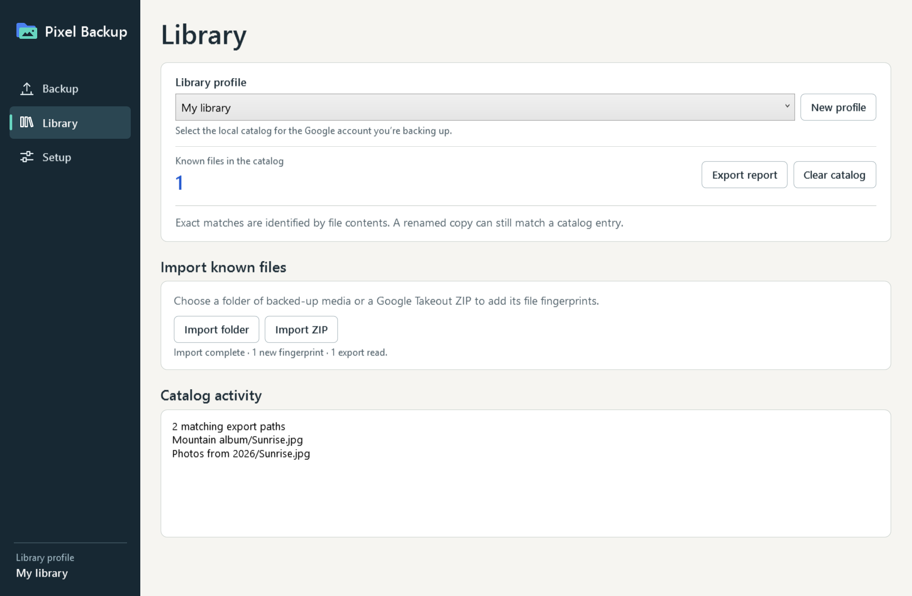

# Exact duplicates and your Google Photos library

Pixel Backup compares the bytes of your media on Windows. A renamed copy of a JPEG gets the same SHA-256 fingerprint as its original. A second camera file named `IMG_0001.JPG` can have entirely different bytes. It stays eligible for backup.

## Read a folder scan

| Scan result | What the app found | With **Skip exact matches** on (default) |
| --- | --- | --- |
| Ready | The first file in this selection with a fingerprint the profile has never seen | Its original relative path is included. |
| Folder copy | Another path in this selection has the same bytes as a **Ready** file | The extra path is skipped. |
| Known copy | The selected profile has that fingerprint from Takeout or a batch you confirmed | Every matching path is skipped. |

Turn off **Skip exact matches** to share every reviewed media path, including copies within the folder and matches already in the profile. Both settings leave the source files in place.

The scanner records each file's size and groups files by the SHA-256 of their full contents. It preserves the selected folder's hierarchy and chooses the first relative path in a consistent sort order for each new fingerprint. A filesystem timestamp or filename change alone leaves the fingerprint intact. Cropping, re-encoding or editing embedded EXIF metadata usually changes the bytes. Visually similar pictures and different frames in a burst therefore remain separate candidates.

Use **Review warnings** to see which files were skipped. Empty or unreadable files, files that change during hashing and media over the scanner's size limits are ineligible for that scan. The scanner skips dot-prefixed paths, folders containing `.nomedia` and filesystem links. A **Ready** file has a recognized media extension. Google Photos decides whether it supports that file's actual codec, dimensions and contents. [Google Photos file requirements](https://support.google.com/photos/answer/6193313?co=GENIE.Platform%3DAndroid&hl=en)

## Tell the app what you already have

In **Library**, use a separate local profile for each Google Photos account. Start with **My library** or select **New profile** and enter a recognizable name. The desktop app uses this local name without a Google sign-in. Check the backup account in Google Photos on the Pixel before importing an export or confirming a batch.

**Import an existing account.** Request a Google Takeout export for **Google Photos** from the intended account. In **Library**, use **Import ZIP** and include each ZIP part Google supplies. You can also extract the parts and use **Import folder** on the Google Photos directory or an individual exported album. The ZIP reader looks for `Takeout/Google Photos/` or `Google Photos/`. If the archive uses a localized folder name, extract it and select that folder. [Google Takeout](https://takeout.google.com/) · [Google’s export and metadata guide](https://support.google.com/accounts/answer/3024190?hl=en)

Use **Backup → Choose folder** for new or unverified media. **Library → Import folder** treats the selected media bytes as evidence that they were already in the account. The importer fingerprints nonempty files with recognized media extensions and skips JSON metadata, filesystem links in extracted folders and top-level sections named `Trash`, `Trashed`, `Bin` or `Failed Videos`. If an import is canceled or fails, previously completed imports are kept.

**Read the report.** One JPEG in both a year folder and an album gives two **export paths** and one known fingerprint. Reimporting the same ZIP at the same location refreshes its paths. Paths from a ZIP stored elsewhere or a different export can appear separately. The preview shows up to 50 matching groups with up to five paths each. **Export report** saves all matching groups, paths, fingerprints and byte lengths as text. Check Google Photos itself to determine how many items exist in the live account. [Documented Takeout layouts](https://github.com/simulot/immich-go/blob/main/docs/misc/google-takeout.md)

**Confirm later batches.** Verify the intended batch in the Google Photos account you selected. On the phone, an item's **More → About → Details** shows its backup status. On the web, check **Recently added** in the same account. When backup finishes, close the previews and select **Stop sharing**. Once the share has closed cleanly, **Confirm backup** asks you to verify the profile and file count. Confirming records the fingerprints of every shared file. Leave a partially verified batch unconfirmed. Windows can miss short reads and cannot determine which uploads Google accepted. [Google’s Android backup checks](https://support.google.com/photos/answer/6193313?co=GENIE.Platform%3DAndroid&hl=en) · [Google’s web backup checks](https://support.google.com/photos/answer/6193313?co=GENIE.Platform%3DDesktop&hl=en)

**When your library changes.** Cloud deletions, edits and partial exports can make the catalog stale. A Storage saver or edited cloud version can have different bytes from the PC original. A new import adds evidence. Previously seen hashes stay in the profile even if later exports omit those files. To rebuild from a fresh snapshot, use **Clear catalog** for that profile, then import the new export. Clearing removes its Takeout and manually confirmed records. The app stores these in a per-profile `backup-library.sqlite3` under `%LOCALAPPDATA%\PixelBackup\Desktop\profiles`. Your source files, ZIPs and actual Google Photos library are untouched.

## What Google can tell a desktop app

Since March 31, 2025, the Google Photos Library API lets an application list, search and retrieve only media items the application created. The Picker API lets the user choose specific items to share with an app. A Windows tool using these APIs cannot silently enumerate everything the Pixel, a browser or another app has uploaded to build a complete hash catalog. Pixel Backup uses local exports and your explicit confirmations. [Google Photos API changes](https://developers.google.com/photos/support/updates) · [Google Photos Picker](https://developers.google.com/photos/picker/guides/get-started-picker)

Google documents that its Library API returns the same media item ID when the same bytes are uploaded again through its media-creation flow. That statement describes the API. Google publishes no equivalent guarantee here for every Android Photos backup, edit or previously imported item. Treat the Windows scan as a way to prevent known byte-for-byte repeats before they reach the phone. [Library API upload behavior](https://developers.google.com/photos/library/guides/upload-media#item-creation-response)

Google Photos **Photo stacks** group similar pictures taken close together. Opening a stack lets you see the other photos. Stacking changes how the library is displayed and leaves its storage usage unchanged. It has no role in the Windows fingerprint comparison. [Google Photos stacks](https://support.google.com/photos/answer/14169846?hl=en)
