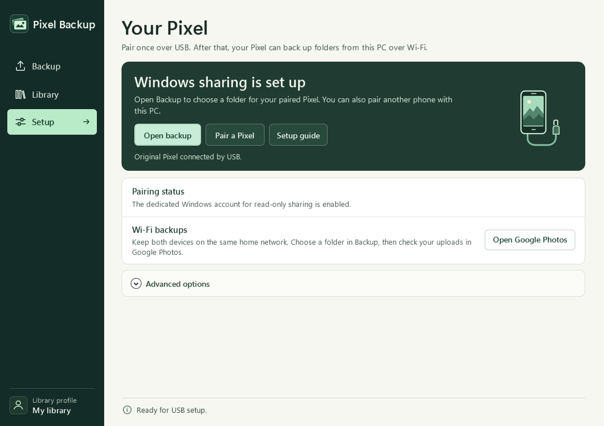

# Pair a Windows PC and a Pixel

Pair the Pixel once by USB. After that, choose a folder in the Windows app and Google Photos can back it up over your home network. The Pixel sees the reviewed files in a read-only folder at `/storage/emulated/0/PixelBackup`. Plug the cable back in when you need to update the software on the phone.

## One-time Windows and Pixel setup

You need a 64-bit Windows 10 or 11 PC, a USB data cable and a Magisk-rooted 2016 Pixel (`sailfish`) or Pixel XL (`marlin`) on stock Android 10 with SELinux enforcing. The photo folder can be on a fixed or removable Windows drive formatted as NTFS, exFAT, FAT or FAT32. The stock Pixel kernel already supports the FUSE mount used here. [Pixel kernel configuration](https://android.googlesource.com/kernel/msm/+/72a7a64494e033f2213c9701dbf137d277bf2026/arch/arm64/configs/marlin_defconfig)

1. **Connect the PC and Pixel.** Put both devices on the same private home network. On the Pixel, enable **USB debugging** in Developer options, unlock the phone's owner profile and connect it as the only USB phone. Have a small Windows folder containing a fresh photo and video ready for your first test. [Android USB debugging](https://developer.android.com/tools/adb#Enabling)
2. **Open Pixel Backup and select your folder.** Extract the Windows release ZIP and run **Pixel Backup.exe** with its support folders beside it. From a source checkout, double-click `windows\Select-PixelFolder.cmd` to build and open the app. In **Backup**, drop your test folder into the folder area or use **Choose folder**. After the scan, open **Setup**. On a fresh installation, choose **Pair my Pixel**. On a PC with an enabled dedicated reader and a saved pairing credential, **Windows sharing is set up** describes the PC. Choose **Open backup** for a previously paired phone or **Pair a Pixel** for a new or replacement phone. Setup checks the current USB connection separately. [Windows releases](https://github.com/supthunder/pixelbackup/releases)
3. **Prepare the USB connection.** The app finds Android Debug Bridge (`adb`) in an existing SDK installation or its own saved tools. If it needs a download, review Google's SDK terms and choose **Agree and download**. The app verifies the package and checks the connected phone. If Setup asks you to authorize the PC, tap **Allow** on the Pixel's USB debugging prompt and retry pairing. [Android SDK Platform-Tools](https://developer.android.com/tools/releases/platform-tools) · [Google SDK terms](https://developer.android.com/studio/terms)
4. **Confirm the photo folder and network.** Pairing reuses the folder you selected. If you went straight to **Setup**, choose the folder the reader should access. When the PC has one suitable network address, the app selects it. If asked to choose, select the Wi-Fi or Ethernet adapter connected to the Pixel's network. The pairing summary shows the folder and address before you continue. Windows requests administrator approval if it needs to create the dedicated local account. On the Pixel, allow **Shell** root access in Magisk when prompted.
5. **Disconnect after setup succeeds.** The app provisions or reuses the local Windows account `PixelReader`, installs the verified Android rclone and FUSE binaries, authenticates to the PC and installs the phone's Magisk startup script. Unplug the cable and return to **Backup** to share the reviewed folder. After each reboot, unlock the Pixel once to start the watcher. [Windows reader setup](../windows/Initialize-PixelReader.ps1) · [Pairing installer](../windows/Install-PixelWatcher.ps1) · [Watcher startup](../android_client/start_pc_watcher.sh)



### Why pairing uses an Android USB tool

Pixel Backup uses `adb` to identify the USB-connected Pixel and install or update the software that mounts Windows folders on it. Automatic discovery checks Android SDK locations and the Windows search path for a supported Google kit. It verifies the executable and companion libraries. To get the USB tools in advance, use **Setup → Advanced options → Prepare USB tools**. To use a custom installation you trust, select **Choose adb.exe…** there. Daily scans and Wi-Fi backups use the Windows app and the already-paired phone. [How Android Debug Bridge works](https://developer.android.com/tools/adb)

The optional download in Pixel Backup 1.1 is Google's Windows Platform-Tools 37.0.1, about 8 MB. The app verifies the package and installs it for the current Windows user under `%LOCALAPPDATA%\PixelBackup\tools\platform-tools-37.0.1`. The SDK download runs with your ordinary Windows permissions. [Google Platform-Tools release notes](https://developer.android.com/tools/releases/platform-tools)

If the app has the USB tools but cannot see the phone, unlock it, check the cable supports data and look for the **Allow USB debugging** prompt. If Windows still lists the Pixel as an unknown device, follow Google's Windows USB driver instructions. [Google USB Driver](https://developer.android.com/studio/run/win-usb)

### Windows folder and network access

On NTFS, pairing grants the dedicated reader inheritable **Read & execute** access to the chosen folder. Select the narrowest folder you want to share. Children with separate permissions can need a read grant of their own. FAT-family drives use the share's read-only permissions.

If Setup lists no network address, open **Windows Settings → Network & internet**, open the properties of your active Wi-Fi or Ethernet connection and enter its IPv4 address in Setup. Reserving that PC address in the router keeps pairing valid across restarts. The phone must be able to reach authenticated SMB on TCP 445. If Windows Firewall blocks SMB, restrict any allowance to the **Private** profile and the Pixel's reserved LAN address. [Windows file sharing](https://support.microsoft.com/en-us/windows/experience/connectivity-networking/file-sharing-over-a-network-in-windows)

If Windows reports an unsigned helper from a downloaded ZIP, run `Get-FileHash .\Pixel-Backup-Windows-x64.zip -Algorithm SHA256` in the download folder. Compare the hash with the release's `.zip.sha256` file. For a matching download, open the ZIP's **Properties → Unblock → Apply**, then extract it again. This applies only to the verified ZIP. [Release checksums](https://github.com/supthunder/pixelbackup/releases) · [Microsoft’s downloaded-script guidance](https://learn.microsoft.com/en-us/powershell/module/microsoft.powershell.utility/unblock-file?view=powershell-5.1)

The desktop pairing helper creates a dedicated password for a new reader. For an existing eligible reader, it can use the saved credential or ask for that reader's current Windows password. Its recovery file, `%LOCALAPPDATA%\PixelBackup-Pairing\PixelReader.clixml`, is protected for the same Windows user on the same PC. On the Pixel, the reader credential is in the root-only `/data/adb/pixel-backup/rclone.conf`. Rclone's password obscuring is reversible. Keep the reader dedicated to this pairing. [Desktop pairing helper](../windows/Pair-PixelDesktop.ps1) · [rclone credential storage](https://rclone.org/commands/rclone_obscure/)

### Upgrade an existing Windows picker pairing

The original whole-folder picker used a watcher that predates filtered batches. If you still have that pairing, close any Photos previews, stop sharing and let the mount detach. Connect and unlock the phone over USB, then open **Setup → Advanced options → Update backup helper**. The update reuses the paired SMB configuration. You can retry an interrupted update. A phone already paired for v1.0 filtered backups can continue using that watcher. [USB upgrade script](../windows/Update-PixelWatcher.ps1)

## Mount and verify

1. Put a previously unuploaded JPEG and a short MP4 in a test folder. In **Library**, select the local profile you use for the intended Google account. In **Backup**, choose the test folder or drop it in the folder area. The scan starts automatically. The default **Skip exact matches** offers one path per new fingerprint and skips files already in the profile. Turning it off offers every reviewed media path. [Exact duplicates and local profiles](DUPLICATES.md)
2. Click **Start sharing**, approve Windows elevation when asked and keep the app open and PC awake. The watcher discovers the matching plan and data shares and mounts only the listed relative paths. The SMB reader has read access to the selected source folder while the share is open. The mount uses rclone with its on-disk media cache off. [Windows share broker](../windows/Share-PixelPlan.ps1) · [Android mount helper](../android_client/mount_pc_folder.sh) · [rclone caching](https://rclone.org/commands/rclone_mount/#vfs-cache-mode-off)
3. On the Pixel, open Google Photos → **Collections → On this device** (older versions use **Library**). Open the JPEG and play the video. Under **Photos settings → Backup → Back up device folders**, enable the folder and check the account that receives the backup. For nested albums, use the folders Photos actually shows. A `.nomedia` file can suppress indexing in its folder and descendants. [Google device-folder backup](https://support.google.com/photos/answer/6193313?co=GENIE.Platform%3DAndroid&hl=en) · [Android media indexing](https://developer.android.com/reference/android/provider/MediaStore#MEDIA_IGNORE_FILENAME)
4. In Google Photos, open each item's **More → About → Details**. Look for **Backed up**, **Original quality**, and the line saying the item uses no account storage. This works with a paid Google One account too. If the storage message is absent, leave the quota treatment unverified. For an independent cloud check, open **Recently added** in a browser signed into that same account, find the files and play the video. [Google Photos web verification](https://support.google.com/photos/answer/6193313?co=GENIE.Platform%3DDesktop&hl=en)
5. Once you have verified the batch, close any open previews and click **Stop sharing**. After a clean stop, click **Confirm backup**, check the named local profile and file count, and record the batch only if you verified those items in that account. If verification is incomplete, leave the batch unconfirmed. Windows can observe a file read over SMB. This alone cannot verify a cloud backup. [Duplicate history](DUPLICATES.md)

In the earlier whole-folder picker test, a physical first-generation Pixel read a JPEG and video over signed SMB 3.1.1 from Windows. Google Photos reported Original quality and zero account storage for both, including after the share disconnected. [Wi-Fi JPEG receipt](evidence/wifi-jpeg.png) · [Wi-Fi MP4 receipt](evidence/wifi-video.png) · [Hardware evidence](STORAGE_REVIEW.md#on-device-result)

## New files, reconnects and later batches

- The desktop share uses the list from the scan. If you add or edit files, stop the session, rescan and start a new batch. Keep the selected folder stable until the batch is verified. A large collection can be shared in albums. The 32 MiB plan limit applies to the UTF-8 list of relative paths. The photo and video bytes travel through the separate data share.
- If albums reuse names such as `IMG_0001.JPG`, select their common parent. The phone then sees paths such as `TripA/IMG_0001.JPG` and `TripB/IMG_0001.JPG`. On Android 10, replacing a file at an old path with the same size and timestamp can cause the media scanner to keep its old entry. [Android change detection](https://github.com/aosp-mirror/platform_packages_providers_mediaprovider/blob/android-10.0.0_r47/src/com/android/providers/media/scan/ModernMediaScanner.java#L337-L367)
- If a new NTFS library is unreadable by the phone, stop sharing, select that folder in **Backup** and open **Connection details → Allow folder access**. This grants the existing `PixelReader` persistent **Read & execute** on the selected folder and inheriting children. Explicit access denials or children with separate permissions may need individual attention. Click **Rescan** and start sharing again. FAT-family drives rely on the read-only share.
- If Wi-Fi drops, restore connectivity and give the watcher time to rediscover the open share. If the PC's LAN IPv4 address changes, restore its reserved address or re-pair. The reader follows Windows password policy. In the **Backup** review, expand **Connection details** to check the reader and its password expiry. You can also run `Get-LocalUser PixelReader | Select-Object PasswordExpires`. An explicit SMB sign-in rejection stops repeated password attempts.
- If Windows reports an existing share after a forced exit, inspect `Get-SmbShare -IncludeHidden | Where-Object Name -like 'PixelBackup*' | Format-List Name,ScopeName,Path,Description,Temporary`. Check the session-specific name, description and path. Windows clears temporary shares at its next restart. [Windows temporary SMB shares](https://learn.microsoft.com/en-us/powershell/module/smbshare/new-smbshare#-temporary)

## Pairing with PowerShell

The desktop app handles USB tool discovery and network selection for ordinary pairing. If you manage your installation from a source checkout, open a regular 64-bit Windows PowerShell window at the repository root. Run the same pairing helper the app uses, with your installed `adb.exe`, a local photo folder and this PC's reachable LAN IPv4. The helper verifies and prepares the phone tools. It asks for Windows elevation only when creating the dedicated local account. [Desktop pairing helper](../windows/Pair-PixelDesktop.ps1) · [Android tools for the phone](../windows/Get-PixelTools.ps1)

```powershell
$adb = (Get-Command adb.exe -ErrorAction SilentlyContinue).Source
if (-not $adb) { $adb = Read-Host 'Full path to the extracted adb.exe' }
$library = Read-Host 'Full path to your existing photo library folder'
$pcAddress = Read-Host 'PC LAN IPv4 address reachable from your Pixel'
.\windows\Pair-PixelDesktop.ps1 -Adb $adb -LibraryPath $library -ComputerAddress $pcAddress
```

To upgrade an existing supported pairing, use `.\windows\Update-PixelWatcher.ps1 -Adb $adb` with the old session closed. The earlier raw PowerShell picker remains available for a whole-folder mount. Its session can expose every readable file in the chosen folder. Use the desktop app for a SHA-256-filtered batch. [Legacy picker](../windows/Select-PixelFolder.ps1)

## Re-pairing or removing the setup

End the sharing session. The installer owns the boot script `/data/adb/service.d/80-pixel-backup.sh`. Its private directory `/data/adb/pixel-backup` contains the mount, watcher and startup scripts, `rclone.conf`, `.pairing-receipt`, `bin/rclone` and `bin/fusermount3`. Inspect the boot script and directory listing as root. Any backup of the configuration should be readable only by root. A cleanup warning after interrupted USB staging identifies the temporary directories for that attempt. [Magisk boot scripts](https://topjohnwu.github.io/Magisk/guides.html#boot-scripts)

To disable automatic startup, move just the verified boot script **outside** `/data/adb/service.d` and reboot the Pixel. To pair with a new PC address or changed reader credential, set aside the verified private installation directory after that reboot, then pair again with the new values. For permanent removal, remove the installation files you have identified. On Windows, remove that reader's explicit read rule on each prepared NTFS library and retire the dedicated local account if it was created for this pairing. Inspect the named credential recovery file before retiring it. The default PC tool cache is `%LOCALAPPDATA%\PixelBackup\tools`. **Clear catalog** applies to the selected local library profile. [Local history and exports](DUPLICATES.md)

## Android mount tools

The installer checks the Android rclone and fusermount3 executables against their pinned hashes before putting them on the phone. Termux builds these Android packages. If the download URL is unavailable, recover those exact versions from a trusted Termux mirror. The original hardware test used rclone 1.76.0 and fusermount3 3.18.3. For manual foreground use with an existing configured remote, the phone scripts require a private root-owned configuration, compatible binaries in a root-owned directory and the global root mount namespace. [Termux rclone package](https://github.com/termux/termux-packages/blob/master/packages/rclone/build.sh) · [Termux FUSE package](https://github.com/termux/termux-packages/blob/master/root-packages/libfuse3/build.sh) · [Magisk namespace setup](https://github.com/master-hax/pixel-backup-gang/blob/7c7c311/docs/EXTERNAL_DRIVES.md#setup)
